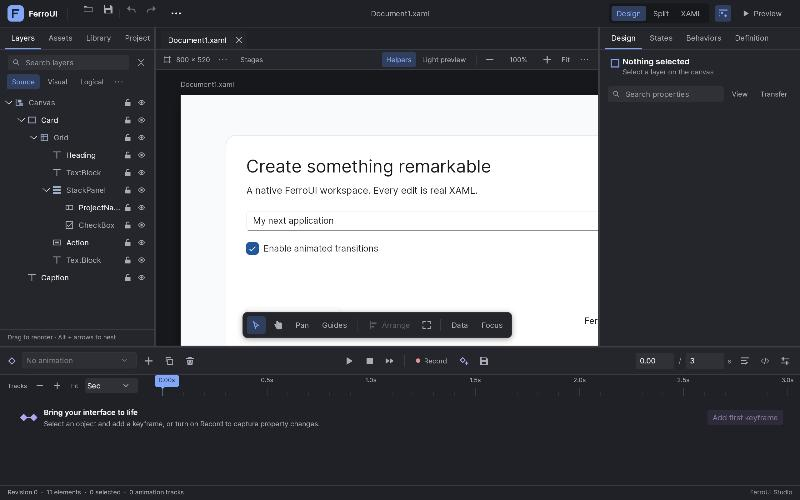

# Designer Studio on FerroUI

This repository is the source and the deployment of the browser site of Designer Studio, the visual
XAML designer of [FerroUI](https://github.com/wieslawsoltes/FerroUI), a cross-platform UI framework
for Rust: an artboard with synchronized XAML, layers, editable properties, layout tools, preview
stages and keyframe animation, as a WebAssembly module on a canvas.

**Open it in the browser:** https://ferroui.github.io/DesignerStudio/



Designer Studio is the sample `samples/DesignerStudio` of FerroUI, built on its `ferroui-designer`
crates ([the designer documentation](https://github.com/wieslawsoltes/FerroUI/blob/main/docs/designer/README.md)),
from the sources of the FerroUI submodule of this repository. This repository adds only what the
browser needs: a host that starts Designer Studio in the page, the host page, and the workflow that
builds the site and publishes it to GitHub Pages. The site has the designer without its desktop host
and without its MCP server; documents live in the memory of the page for the time it is open.

## Repository layout

| Path | Content |
|---|---|
| `DesignerStudio.Browser/` | the browser host (`designer-studio-browser`): the WebAssembly entry point and its host page in `wwwroot/` |
| `FerroUI/` | FerroUI as a git submodule; Designer Studio and the framework crates build from it |
| `.github/workflows/ci.yml` | the build of the site and its deployment, with FerroUI's shared application workflow |

The repository follows the layout of FerroUI applications described in
[FerroUI/docs/apps.md](https://github.com/wieslawsoltes/FerroUI/blob/main/docs/apps.md): the workspace
dependencies and profiles of `Cargo.toml` are kept in step with the submodule by
`FerroUI/scripts/apps/sync-workspace.py`.

## Build

Every push to `main` builds the site and deploys it to GitHub Pages; pull requests build it and run
the smoke test without deploying. The browser test `DesignerStudio.Browser/tests/browser-smoke.mjs` then
opens the built site in Chrome and clicks the Preview button, and fails on any console error. To build the site yourself:

```sh
git clone --recurse-submodules https://github.com/FerroUI/DesignerStudio.git
cd DesignerStudio
FerroUI/scripts/browser/setup.sh .tools
source .tools/env.sh
FERROUI_BROWSER_WORKSPACE=$PWD FerroUI/scripts/build-browser.sh designer-studio-browser
```

`setup.sh` installs the browser toolchain FerroUI pins (the `wasm32-unknown-emscripten` target,
Emscripten and the `wasm-bindgen` command-line tool); see
[FerroUI/docs/porting/browser-platform.md](https://github.com/wieslawsoltes/FerroUI/blob/main/docs/porting/browser-platform.md).
Serve the directory the script prints with any static web server. `?RenderingMode=Software2D` in the
address of the page draws without WebGL.

## Update FerroUI

```sh
git -C FerroUI fetch origin && git -C FerroUI checkout origin/main
python3 FerroUI/scripts/apps/sync-workspace.py .
cargo update --workspace --offline
```

## Licence

MIT, as FerroUI ([LICENSE](LICENSE)). See [NOTICE.md](NOTICE.md).
